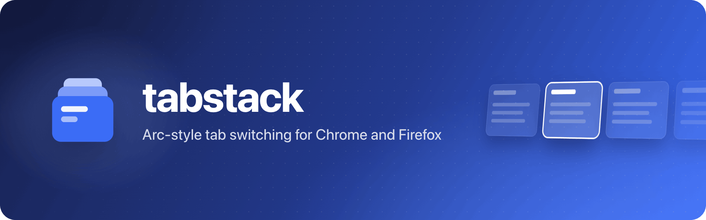
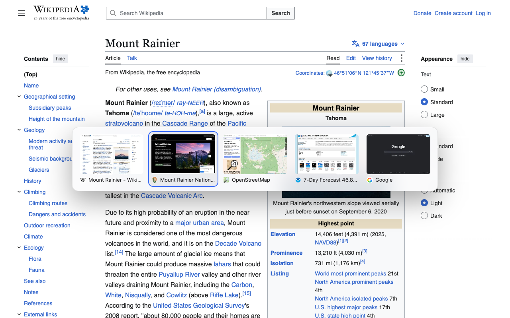
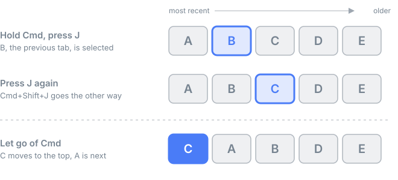
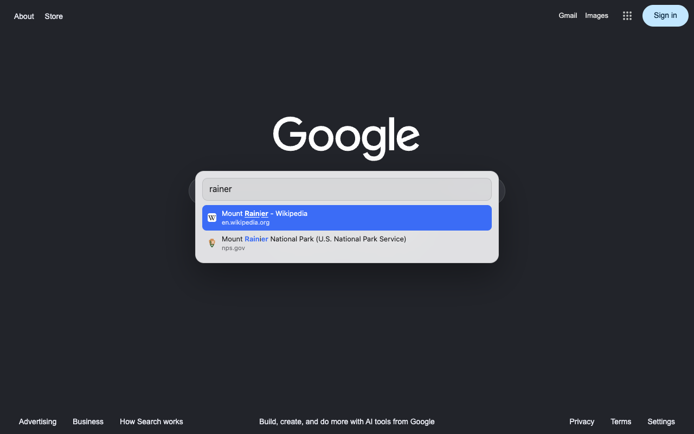
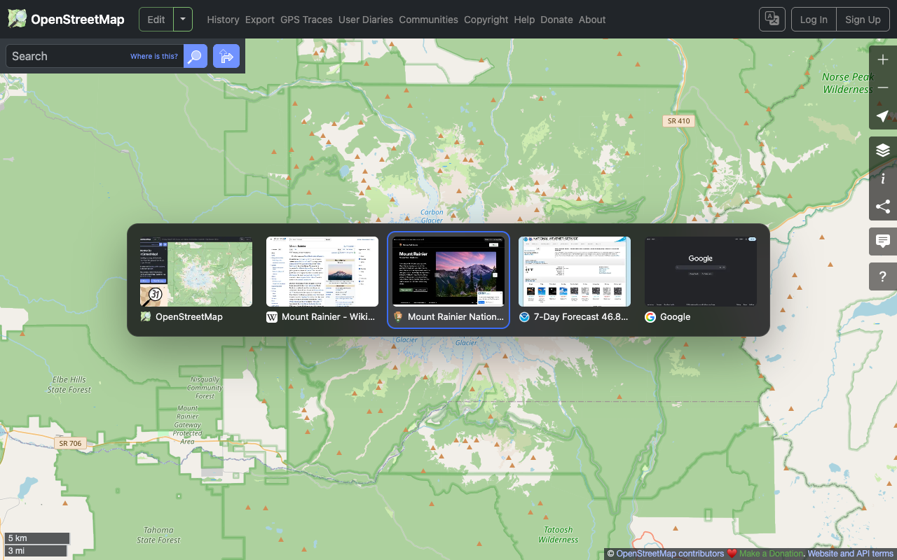
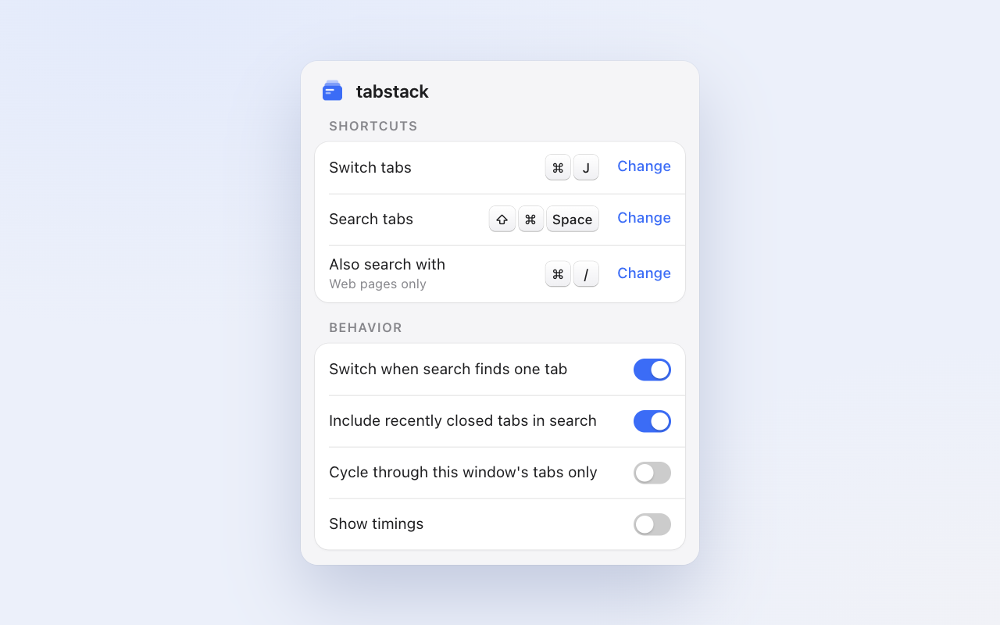
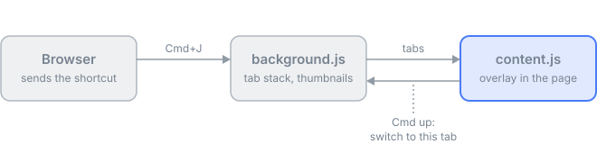

  

tabstack orders your tabs by when you last used them, so Cmd+J always takes you back to the tab you were just on. It also works in Zen and other browsers built on Firefox.

  

## Shortcuts

On Windows and Linux, use Ctrl in place of Cmd.

| Keys | What it does |
| --- | --- |
| Cmd+J | Switch to your last tab |
| Hold Cmd, press J again | Go further back, then let go of Cmd to switch |
| Cmd+Shift+K | Search your open and recently closed tabs |
| Cmd+/ | Search too, but only on web pages |

  

While the switcher is open:

- **Backspace** or **X** closes the selected tab (Cmd+Backspace while searching)
- **Cmd+Shift+J** steps forward again
- **Esc** cancels
- **Arrow keys** and **Tab** move the selection

## Search

Type to filter and press Enter to switch. Search matches a tab's title, site and address, so "gpr" finds **G**itHub **P**ull **R**equest and "githb" still finds GitHub.

  
  

## Settings

Click the toolbar icon to change the shortcuts and a few options. The icon turns red when another extension already has Cmd+J.

  

## Browser pages

Browsers don't let extensions draw on their own pages, like `chrome://` pages and the new tab page. On those pages:

- Cmd+J still switches, but no cards appear until you reach a web page.
- Search opens in the toolbar popup.

## How it works

The browser tells an extension when a shortcut is pressed, but not when Cmd comes up. So tabstack draws its overlay inside the page, where it can watch the keys.

  

It's plain JavaScript with no dependencies. All the code is in `src/`.

| File | Job |
| --- | --- |
| `background.js` | Tab stack, thumbnails and shortcuts |
| `content.js`, `ui.js` | The overlay in each page |
| `relay.js` | Passes keys from iframes to the overlay |
| `switcher.js` | Search on browser pages |
| `settings.js` | The settings popup |

## Development

To load your copy of `src/` in place of the store version:

- **Chrome.** Open `chrome://extensions`, turn on Developer mode, click "Load unpacked" and pick `src/`.
- **Firefox and Zen** (128 or later). Run `bun build.mjs`, open `about:debugging#/runtime/this-firefox`, click "Load Temporary Add-on" and pick `dist/firefox/manifest.json`.

To release, bump `version` in `src/manifest.json`, run `bun build.mjs`, and upload the two zips it writes to `dist/`. The listing text is in `store/listing.md`.

## License

MIT, see [LICENSE](LICENSE).
