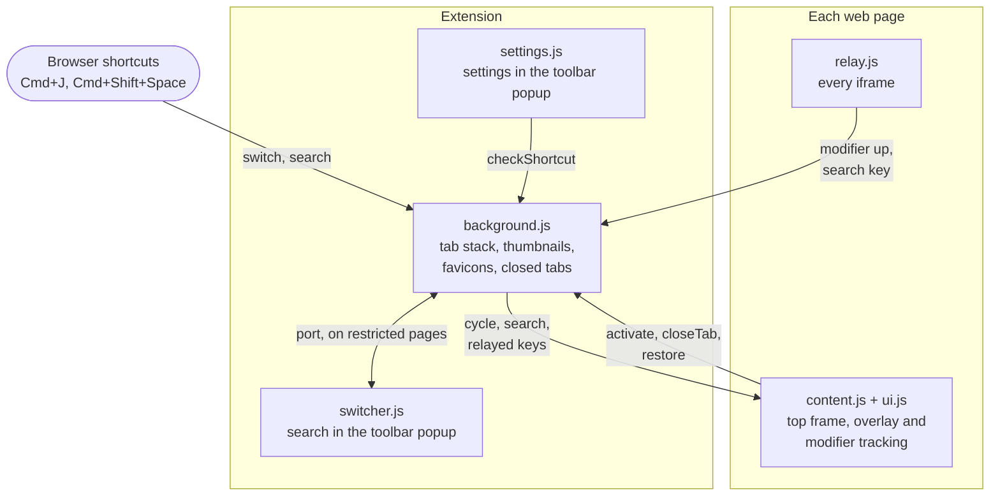

# tabstack

tabstack is an Arc-style recent-tab switcher for Chrome and Firefox, and for Zen, which is built on Firefox. It keeps your tabs in a stack ordered by when you last used them, so a tap of Cmd+J takes you back to the tab you were just on, holding Cmd and pressing J again flips further back through thumbnails of your recent tabs, and a fuzzy search finds any open or recently closed tab.


## Using it

Shortcuts are given for macOS. On Windows and Linux, Ctrl takes the place of Cmd.

- **Cmd+J** switches to the last tab you used. Hold Cmd and keep pressing J to go further back through your five most recent tabs (fewer in a narrow window), then let go of Cmd to switch to the selected one. The cards only appear once you've held Cmd for 120 ms, so a quick tap switches without drawing anything. Cmd+Shift+J steps forward again, the selection wraps around at the end, and older tabs are reached through search.
- **Cmd+Shift+Space** searches your tabs from any page. It's a placeholder default, so you may want to change it in the settings. **Cmd+/** also searches, but only while a web page has focus, because tabstack listens for it inside the page instead of through the browser. Type to filter and press Enter to switch. When exactly one open tab matches, tabstack switches to it after a short pause.
- **The toolbar icon** opens the settings. It turns red when the switch shortcut isn't set, which happens when another extension already has Cmd+J.


While the switcher is open, these keys work:

- **Backspace** or **X** closes the selected tab while cycling, and **Cmd+Backspace** does it while searching. When you close one while cycling, the next tab down the stack moves up into the gap.
- **Either search shortcut** turns a cycle into a search, without letting go of Cmd first.
- **Esc** cancels, the arrow keys and Tab move the selection, and clicking a card or row switches to that tab.

### Search

Search looks at each tab's title, site and address in three tiers, and the first tier with any hits wins, so a precise query isn't buried under loose matches.

1. exact substrings
2. letters in order, so "gpr" finds **G**itHub **P**ull **R**equest
3. near misses, like "githb" or "reqeust"

Matched letters are highlighted, and tabs playing sound show a speaker. Once you start typing, recently closed tabs appear below the open ones, and Enter reopens them.

<p>


</p>

### Settings

The toolbar popup has these settings:

- **Switch tabs** and **Search tabs** are the browser shortcuts. Firefox lets you record a new one in the popup. Chrome has no API for rebinding them, so its Change button opens `chrome://extensions/shortcuts` instead. Whichever modifier the switch shortcut uses is the one whose release ends a cycle.
- **Search from a page** is the in-page shortcut, Cmd+/ by default.
- **Switch when search finds one tab**, **Include recently closed tabs in search**, **Cycle through this window's tabs only** (search still covers every window) and **Show timings**, which prints latency numbers under the switcher.

A shortcut you record in the popup has to include Cmd, Ctrl or Alt, so it doesn't fire while you type.

### Pages extensions can't run on

Browsers don't run extension scripts on their own pages, such as `chrome://` and `about:` pages, the new tab page and the extension stores, so tabstack can't draw its overlay there. It treats `view-source:`, `file:` and `data:` pages the same way.

- On one of those pages, Cmd+J switches to the previous tab straight away, and that tab's overlay carries on the cycle.
- If the previous tab is one of those pages too, Cmd+J just switches to it. tabstack can't tell when Cmd comes up on these pages, so it goes by time: presses less than 0.3 s apart count as holding Cmd and step one tab further back, and a slower press starts over and flips back. Nothing is drawn while this happens. When the presses reach a web page, its overlay appears and carries on the cycle.
- Firefox doesn't tell a page that the modifier came up when it went down on another page. After a jump in Firefox, the overlay stays hidden until the page's first key press or mouse movement shows whether Cmd is still held.
- Search on those pages opens in the toolbar popup, or in a small window when the popup won't open.

## How it works

tabstack is plain JavaScript with no bundler and no dependencies. Chrome loads `src/` as it is, under Manifest V3, and `build.mjs` writes a Manifest V2 copy for Firefox.

The browser's commands API tells an extension when a shortcut is pressed, but never when its modifier comes up, so the overlay runs inside the page, where it can watch the keys itself. The background script answers the shortcut by sending the page the tabs it can cycle through, and the page tells the background which tab to switch to once Cmd comes up.



Keys typed inside an iframe never reach the top frame, so `relay.js` sends them to the background, which forwards them to the top frame's `content.js`. On pages the overlay can't run on, search connects to the background over a port from the toolbar popup instead. Settings are saved in `storage.sync`, and the background and page scripts pick up changes as they happen.

| File | What it does |
| --- | --- |
| `background.js` | Holds the tab stack, thumbnails, favicons and recently closed tabs, and routes both shortcuts. It runs as Chrome's service worker and as Firefox's background page. |
| `content.js` | Runs in each page's top frame. It watches the modifier and shows the switcher as a popover in a closed shadow root. |
| `ui.js` | The switcher, shared by the overlay and the popup. It draws the cards and search rows, handles keys and ranks search results. It builds DOM without `innerHTML` and draws images on canvas, so a page's CSP or Trusted Types can't break it. |
| `relay.js` | The only script in iframes, and kept small because it loads into every frame. It forwards the modifier release and the in-page search shortcut to the top frame. |
| `switcher.html`, `switcher.js` | Search on pages the overlay can't run on, shown in the toolbar popup (`switcher.html?popup`) or a small window. |
| `settings.html`, `settings.js` | The toolbar popup the rest of the time. |
| `shared.js` | Settings defaults and shortcut helpers, loaded by every context. |
| `manifest.json` | The Chrome manifest. `build.mjs` derives the Firefox one from it. |

The SVGs in `icons/` are the sources the PNGs in `src/icons/` were rendered from, and `store/` holds the store listing text and images.

### Thumbnails

- tabstack captures a tab 400 ms after you arrive on it, again just before you leave it with the shortcut, and every 30 seconds while you're active on it.
- It keeps thumbnails for the 50 most recent tabs for the browser session, and saves the last 100 by page URL in local storage, so tabs restored after a restart show the picture from their last visit. Incognito tabs are left out of the saved ones.
- Chrome can only capture the tab on screen. Firefox also captures loaded background tabs at startup.

### Why Firefox gets Manifest V2

Under Manifest V3, Firefox only lets an extension call `captureVisibleTab` on a tab it was just invoked on (`activeTab`), however much host access it has, so thumbnails would only come from pressing the shortcut. Manifest V2's `<all_urls>` permission can capture any tab, and `tabs.captureTab` covers background tabs as well.

## Install and build

### Chrome

1. Go to `chrome://extensions` and turn on Developer mode.
2. Click "Load unpacked" and pick `src/`.

After changing `src/`, reload the extension on that page.

### Firefox and Zen

tabstack needs Firefox 128 or later. Build the Firefox copy first.

```sh
bun build.mjs
```

Then go to `about:debugging#/runtime/this-firefox`, click "Load Temporary Add-on" and pick `dist/firefox/manifest.json`. Rerun the build after changing `src/`.

### Build

`build.mjs` only uses built-in modules, so there's nothing to install, though it calls the `zip` command for the store packages. It clears `dist/` and writes these files:

- `dist/firefox/`, the unpacked Firefox build
- `dist/tabstack-<version>-chrome.zip` for the Chrome Web Store
- `dist/tabstack-<version>-firefox.zip` for addons.mozilla.org

### Release

1. Bump `version` in `src/manifest.json`. Both stores refuse an upload whose version they've already seen.
2. Run `bun build.mjs`.
3. Upload each zip. The listing text, permission justifications and reviewer notes are in `store/listing.md`, and the images are in `store/`.

## Still to test by hand

1. **Cmd+Shift+J in Firefox.** On macOS it's also Firefox's Browser Console shortcut, and the page may not be able to stop it.
2. **Cold worker latency in Chrome.** Turn on Show timings, stop the worker at `chrome://serviceworker-internals`, then hold Cmd+J.
3. **Two `chrome://` pages in a row.** Separate taps should flip between them, and quick presses with Cmd held should step further back.

## License

MIT, see [LICENSE](LICENSE).
